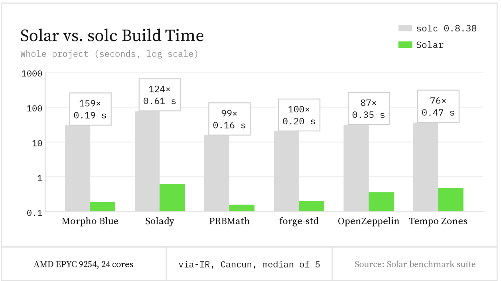
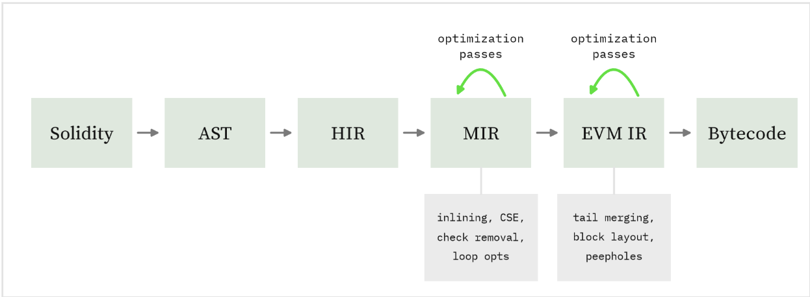

# solar

[](https://crates.io/crates/solar-compiler)
[](https://crates.io/crates/solar-compiler)
[](/LICENSE-MIT)
[](/LICENSE-APACHE)
[](https://github.com/paradigmxyz/solar/actions)
[][tg-url]

A fast, optimizing Solidity compiler written in Rust.

We compile Solidity 0.8.x to EVM bytecode, with detailed diagnostics and a modular Rust API.
The compiler ships with Foundry and powers its Solidity language server.

<p align="center">
    <picture align="center">
        
    </picture>
</p>

## Getting started

Update [Foundry](https://getfoundry.sh/introduction/installation/), then choose the compiler with
`--use solar`:

```bash
foundryup
forge build --use solar
forge test --use solar
```

Run `forge lsp` in your project for editor support: diagnostics, hover, completion, go to
definition and rename. The [VS Code and Zed clients](https://github.com/foundry-rs/foundry/pull/16730)
are maintained in Foundry.

> [!CAUTION]
> Code generation is under active development.
> Please do not use it in production environments.

## Performance

On six real-world projects, builds were **about 100× faster on average** than solc's via-IR pipeline,
reaching **159×** on Morpho Blue.



Measured at [commit `0303bb7d`](https://github.com/paradigmxyz/solar/commit/0303bb7d) against
solc 0.8.38, targeting Cancun. Build times are the median of five runs on an AMD EPYC 9254
(24 cores), using our default eight threads and one for solc.

Across our runtime corpus, using each project's own compiler settings, the generated contracts
used **5% less gas**, cost **26% less gas to deploy** and had **29% smaller bytecode** on average
than those compiled with solc.
See the [results](https://www.getfoundry.sh/perf/solar/?head=0303bb7d#benchmarks) and
[benchmark instructions](benches/runtime/README.md) for inputs, settings and how to reproduce them.

With our compiler, [Safe Solady](https://github.com/paradigmxyz/solady/tree/feat/safe-solady-natspec)
used **19% less gas per test** than the original library compiled with solc, measured as a
geometric mean over Solady's own tests. Most code is plain, checked Solidity; assembly and
`unchecked` remain in small functions tagged for review.

## How it works



MIR keeps Solidity types and operations, so passes can remove redundant checks, inline functions
and avoid repeated storage and memory accesses. EVM IR handles stack operations, block layout,
tail merging and peephole rewrites before assembly.

See the [MIR reference](docs/MIR.md) and [codegen guide](docs/CODEGEN.md) to work on the compiler.

## Standalone compiler

Pre-built binaries for macOS, Linux and Windows are on the
[releases page](https://github.com/paradigmxyz/solar/releases).

On macOS and Linux:

```bash
curl -LsSf https://paradigm.xyz/solar/install.sh | sh
```

On Windows:

```powershell
powershell -c "irm https://paradigm.xyz/solar/install.ps1 | iex"
```

Or install with [`cargo binstall`](https://github.com/cargo-bins/cargo-binstall):

```bash
cargo binstall solar-compiler
```

To build the latest development version from source:

```bash
cargo install --git https://github.com/paradigmxyz/solar --locked
```

Compile a contract:

```bash
solar Counter.sol -Ogas --emit=abi,bin

# Compile a file with a Foundry project's remappings.
solar $(forge remappings) src/Contract.sol -Ogas --emit=bin

solar --help
```

## Library and API usage

Add the Rust library:

```bash
cargo add solar-compiler --rename solar --no-default-features
```

Pin the resulting version with `=` in `Cargo.toml`: versioning tracks binary compatibility,
not the Rust API. See the [examples](examples) for embedding the compiler.

For C, WebAssembly and JavaScript, [`solar-capi`](crates/capi/README.md) provides a Solidity-compatible
C API and a `soljson.js` wrapper. Both accept Standard JSON input and return Standard JSON output.

We target the latest stable Rust release. The minimum supported Rust version may change at any time.

## Contributing

See the [contributing guidelines](CONTRIBUTING.md) for building, testing and working on the compiler.
Upcoming work is tracked in the [roadmap](https://github.com/paradigmxyz/solar/issues/1).

## Support

If a project fails to compile or behaves differently from solc, [open an issue](https://github.com/paradigmxyz/solar/issues/new)
or ask on [Telegram][tg-url].

[tg-url]: https://t.me/paradigm_solar

#### License

<sup>
Licensed under either of <a href="LICENSE-APACHE">Apache License, Version
2.0</a> or <a href="LICENSE-MIT">MIT license</a> at your option.
</sup>

<br>

<sub>
Unless you explicitly state otherwise, any contribution intentionally submitted
for inclusion in these crates by you, as defined in the Apache-2.0 license,
shall be dual licensed as above, without any additional terms or conditions.
</sub>
