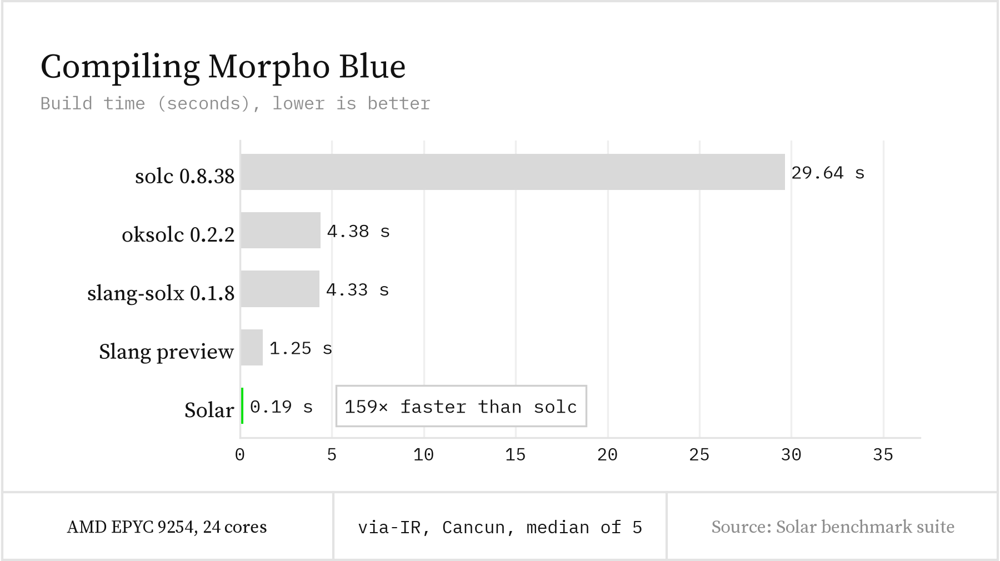
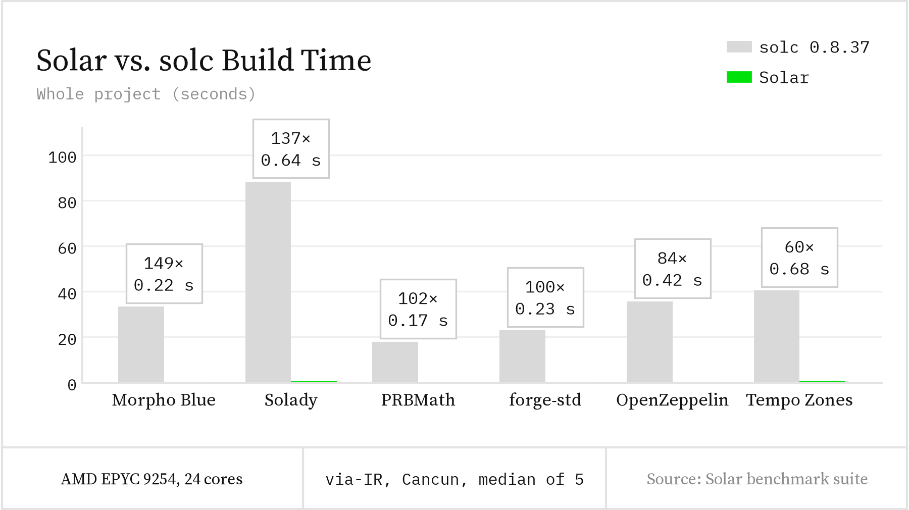
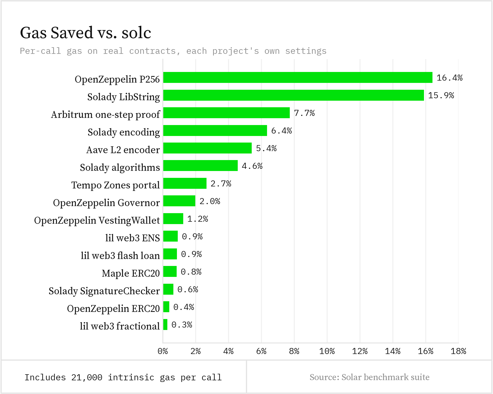
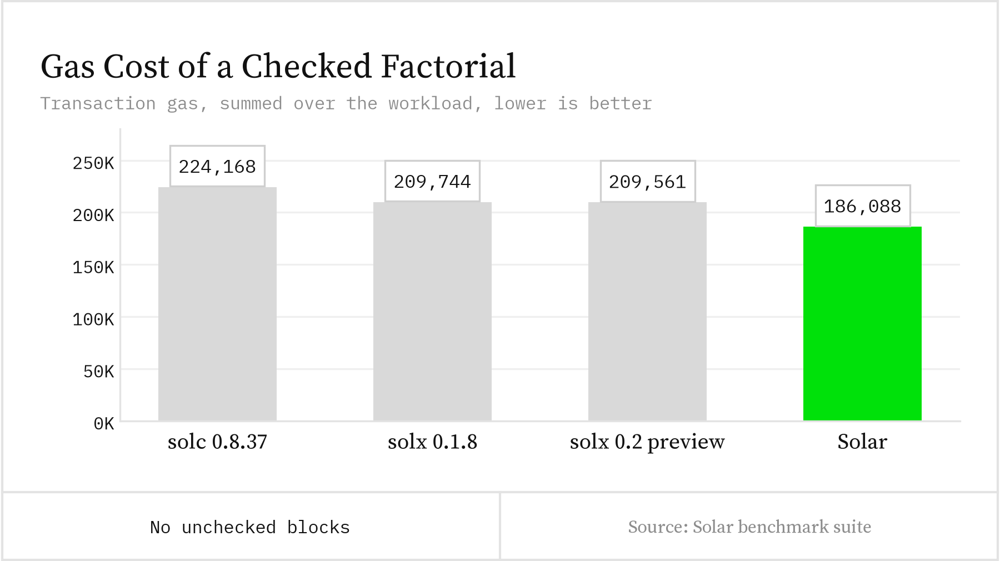
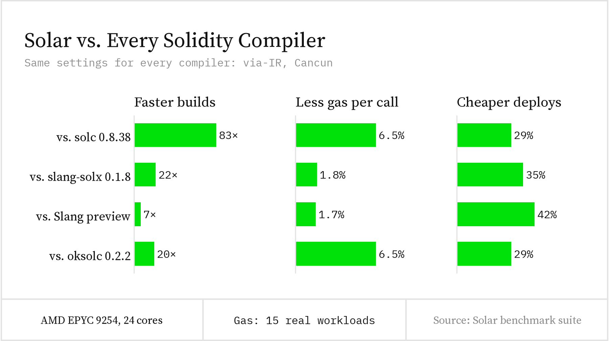
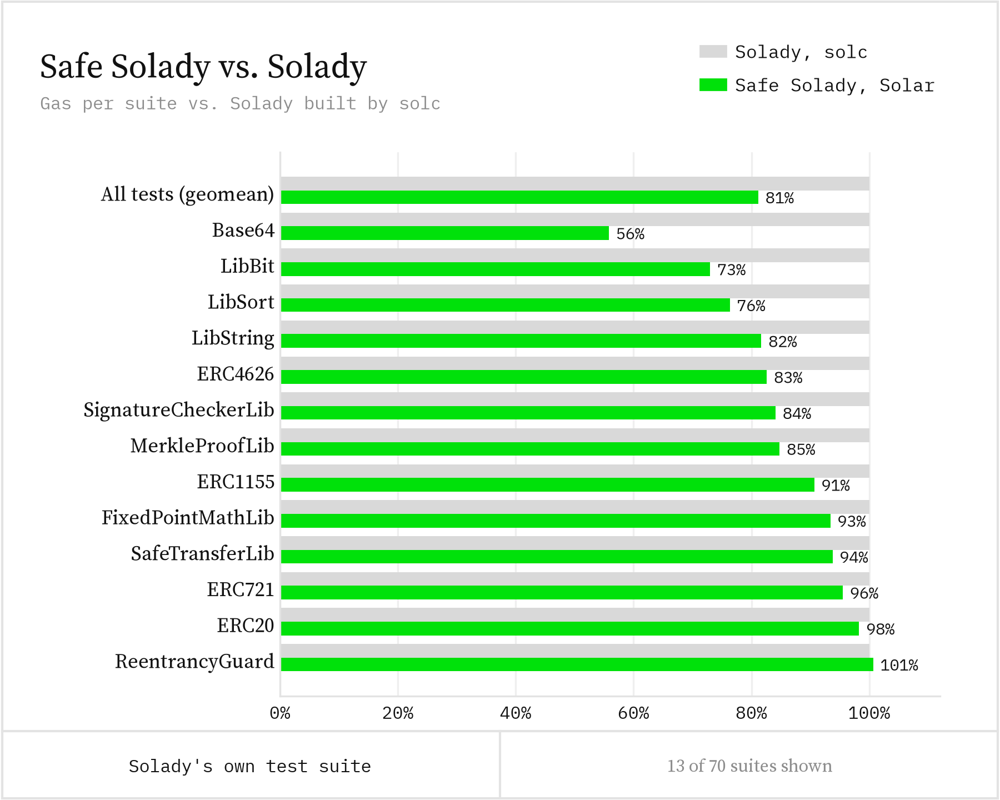
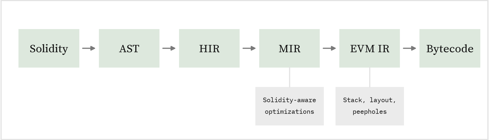

# Solar: 100× faster Solidity compilation, cheaper contracts

*By DaniPopes, Djordje Todorovic, Georgios Konstantopoulos [byline TBD]*

**Today we are excited to release Solar v0.3, the first version of our Rust Solidity compiler that generates EVM bytecode. Solar compiles Morpho Blue over 100× faster than solc, its contracts are cheaper to deploy and to run, and safe Solidity compiled with Solar beats hand-written assembly. It ships in Forge today.**

Two years ago, [we introduced Solar](https://www.paradigm.xyz/writing/solar) ☀️ as a fast, modular Solidity frontend. Since then, we have built a full optimizing compiler behind it: a typed middle end that models Solidity, and a back end that models the EVM. Specifically:

* **Over 100× faster builds:** Solar compiles Morpho Blue in 0.22 seconds, against 33 seconds for solc.
* **Cheaper contracts by default:** On real-world contracts, Solar's code uses 4% less gas to run, costs 26% less to deploy and is 30% smaller than solc's. On average, it also beats solx and every other Solidity compiler we tested.
* **Safe code that beats assembly:** We rewrote Solady without inline assembly or `unchecked` math. Compiled with Solar, it uses 19% less gas than the original assembly compiled with solc.
* **A language server in Forge:** `forge lsp` brings Solar's analysis to any editor: go to definition, rename, completion and errors as you type.

If that sounds exciting, read on!

# Solar is fast.

Solar compiles Morpho Blue in 0.22 seconds. solc takes 33.

Compilation is the inner loop of smart contract development. Every `forge build` and `forge test` waits on it, and teams that turn on solc's via-IR pipeline for cheaper code often wait tens of seconds per build. As we [wrote when we announced Solar](https://www.paradigm.xyz/writing/solar), testing was no longer Foundry's bottleneck; the compiler was.

We compiled Morpho Blue with every Solidity compiler we could find, using the same settings for all of them:



*Settings: via-IR and the Cancun EVM target, the only ones every compiler accepts.*

The gap holds across the ecosystem. On six widely used codebases, Solar builds the whole project 60× to 149× faster than solc:



With these settings, solc cannot build Uniswap v4 core or Seaport at all; it runs out of stack slots. Solar builds Uniswap v4 in 0.39 seconds and is the only compiler we tested that builds Seaport.

Across every project we built, including ones not shown here, Solar is 80× faster than solc on average with these settings, and still 30× faster when each project keeps its own settings, where many use solc's quicker legacy pipeline. It also needs a fraction of the memory: 322 MiB to build Solady, where solc needs 2.7 GiB. Solar spreads work over eight threads by default, but even on one thread it compiles Morpho Blue over 20× faster than solc.

# Solar makes your contracts cheaper.

A fast compiler is only useful if its output is good. So we built a [benchmark suite](https://github.com/paradigmxyz/solar/tree/main/benches/runtime) from real contracts by OpenZeppelin, Solady, Aave, Arbitrum, Maple, Tempo and others. For each one, we deploy every compiler's bytecode to a local node, replay the same transactions, and check that all of them return the same results.

With each project's own settings, Solar beats solc on every one of these workloads:



Compute-heavy code gains the most, such as OpenZeppelin's P256 signature verification and Solady's string library. Even simple token calls get cheaper, although the 21,000 gas every transaction pays before running any code limits the gain. Solar's contracts also cost 26% less to deploy and are 30% smaller.

Developers have learned to hand-optimize around the compiler, and Solar makes much of that unnecessary. Take the first example from [solx's launch post](https://paragraph.com/@zksync/solx-the-new-solidity-compiler-why-it-matters-to-you), a factorial that writes to storage on every iteration:

```solidity
contract FactorialStorage {
    uint256 public result;

    function computeFactorial(uint256 n) external {
        result = 1;
        for (uint256 i = 2; i <= n; ++i) {
            result *= i;
        }
    }
}
```

solx needed `unchecked` math to move the storage write out of the loop. Solar does not: it keeps `result` on the stack, with every overflow check intact, and writes storage once at the end, since a revert would undo any earlier write anyway.



Write the obvious code; Solar makes it cheap.

# How does Solar compare?

We are glad to see more teams investing in Solidity compilers. We measured solc, [solx](https://github.com/NomicFoundation/solx) from the Nomic Foundation (the team behind Hardhat), the October preview of its upcoming Slang-based rewrite, and [oksolc](https://github.com/okcontract/oksolc), a port of solc to Zig, all on the same inputs and settings. Solar builds whole projects faster than all of them, and its code costs less to run and to deploy:



These numbers use one setting for every compiler, so the solc figures differ from those above: forcing via-IR slows solc down and makes its code more expensive on projects built for its legacy pipeline. Solar does not win everywhere. solx beats it on P256 signature verification, and the Slang preview on four of fifteen workloads.

The full results are in our [benchmark suite](https://github.com/paradigmxyz/solar/tree/main/benches/runtime).

# With Solar, safe Solidity beats assembly.

Today, the cheapest Solidity is written in inline assembly with `unchecked` math. Libraries like [Solady](https://github.com/Vectorized/solady) save every unit of gas by hand, but every line of assembly skips the compiler's checks, and one mistake can cost users their funds. We think the compiler should do this work, not the developer.

To test that idea, we rewrote Solady in plain, checked Solidity ([safe Solady](https://github.com/djolertrk/solady/tree/feat/safe-solady-natspec) [move to paradigmxyz before publishing]). Assembly and `unchecked` remain only in small functions tagged for review, which do what Solidity cannot express, such as reading a raw storage slot or bubbling up a revert. The rewrite keeps every function Solady exposes.

We then ran Solady's own test suite against both versions. They produce the same results. Compiled with Solar, safe Solady uses **19% less gas** per test on average than the original assembly compiled with solc, and it is cheaper in nearly every test:



Readable, checked code that is cheaper than hand-written assembly. That is what a compiler should give you.

*[Editorial: this section depends on [paradigmxyz/solar#1999](https://github.com/paradigmxyz/solar/pull/1999) landing before the release.]*

# How is Solar built?

Solar follows the design of modern compilers like rustc and LLVM, where each stage has one job:



MIR is a typed view of your contract that still knows what a mapping or a checked addition is, so it can remove redundant checks and keep values out of storage and memory. EVM IR sits close to the machine and handles the stack, block layout and peephole rewrites. Keeping each optimization at the level where it belongs makes it small, easy to test and easy to build on.

# Solar runs in your editor.

`forge lsp`, a Solidity language server built into Forge, runs on Solar's frontend. It reads your `foundry.toml` and remappings, so it resolves imports the way `forge build` does, and it analyzes the whole project, not only the open files.

In a project, `forge lsp` opens VS Code with the bundled Foundry Solidity extension. Other editors with language server support, such as Neovim, Zed or Helix, can run `forge lsp --stdio`. You get go to definition, find references and rename across the project; completion with NatSpec tags, hover docs and signature help; inlay hints, call and type hierarchies; formatting; and compiler errors as you type.

# Solar ships in Forge.

Solar is part of [Forge](https://github.com/foundry-rs/foundry), so there is nothing else to install. Today you opt in with `--use solar`. Next, we will make it the default, so every `forge build` uses Solar with no flag.

We check every change to Solar against solc in a differential benchmark, and we run the full test suites of Morpho Blue, Solmate, Solady, Seaport, OpenZeppelin and Uniswap v4 under both compilers, with the same results [re-verify on the release commit].

## OK, I'm sold! How do I try Solar?

Update Foundry, then pass `--use solar` to any `forge` command:

```bash
foundryup
forge build --use solar
forge test --use solar
```

To try the language server, run `forge lsp` in your project.

If your project does not build, or a test behaves differently than with solc, please [open an issue](https://github.com/paradigmxyz/solar/issues). No feedback helps us more.

# Where do we go from here?

In the last two years, we have:

1. [Announced Solar](https://www.paradigm.xyz/writing/solar) as a fast Solidity frontend.
2. Integrated Solar into Forge, where it runs `forge lint` and `forge fmt`.
3. Built a typed middle end (MIR) and a machine-level back end (EVM IR).
4. Shipped code generation that beats solc on speed and gas, and `forge lsp` (this post).

Next, we are most excited about:

* **Security from the compiler:** Our IRs know far more about a contract than its bytecode does. We will use them to prove that optimizations preserve behavior, extend the Lean proofs we already have for our rewrite rules, and flag dangerous patterns before they ship. Safe Solady is the first step, and Solar will report which contracts contain no assembly or `unchecked` code outside reviewed functions.
* **A Solar standard library**, so that safe primitives need no assembly at all.
* **Debug info** through [ethdebug](https://github.com/ethdebug/format), so optimized contracts stay easy to debug.
* **LLM-assisted optimizations**, where models propose transformations and the compiler proves them correct before applying them.

Run `foundryup`, try Solar on your contracts and tell us what you find.

**We're hiring compiler engineers to work on Solar. Reach out with your GitHub and resume to [georgios@paradigm.xyz](mailto:georgios@paradigm.xyz).**

See you on [GitHub](https://github.com/paradigmxyz/solar)!
