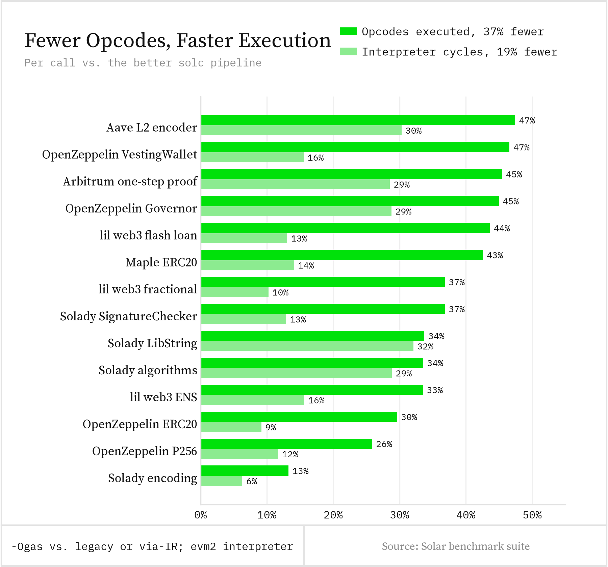

# Solar: 100× faster Solidity

*By DaniPopes, djtodoro, Georgios Konstantopoulos*

Two years ago, [we introduced Solar](https://www.paradigm.xyz/writing/solar) ☀️ as a fast, modular Solidity frontend. Since then, we've added a full optimizing compiler, with a typed middle end that models Solidity and a backend that models the EVM. Today we're releasing Solar v0.3, our Solidity compiler written in Rust, and the first version that generates EVM bytecode. It ships in Forge, and it introduces:

* **100× faster builds:** Solar builds six real-world Solidity projects 100× faster than solc on average with via-IR, and up to 159× faster.
* **Cheaper contracts by default:** Solar's code uses 5% less gas to run, costs 26% less to deploy and is 29% smaller than solc's. On average, it also beats every other Solidity compiler we tested.
* **Safe code that beats assembly:** Solady rewritten without inline assembly or `unchecked` math uses **19% less gas** with Solar than the original does with solc.
* **A language server in Forge:** `forge lsp` brings Solar's analysis to any editor.

# Solar is fast.

Compilation is the inner loop of smart contract development: both `forge build` and `forge test` wait for it. With solc's via-IR pipeline enabled for cheaper code, it often takes tens of seconds per build. As we wrote when we announced Solar, solc had become Foundry's bottleneck.

We compiled six real-world projects with Solar and with solc's via-IR pipeline:


*solc 0.8.38 and Solar at commit 0303bb7d. Solar uses its default eight threads, and solc uses one.*

With via-IR, solc fails on Uniswap v4 core and Seaport with "Stack too deep". Solar compiles Uniswap v4 in 0.35 seconds, and of the five compilers we tested, only Solar builds Seaport with via-IR.

With each project's own settings, many of them on solc's quicker legacy pipeline, Solar is over 30× faster on average and needs about a third of solc's memory. On one thread instead of its default eight, Solar is still 19× faster than solc with via-IR, and 7× faster with each project's own settings.

# Solar makes your contracts cheaper.

We built a [benchmark suite](https://github.com/paradigmxyz/solar/tree/main/benches/runtime) using contracts from OpenZeppelin, Solady, Aave, Arbitrum, Maple, Tempo and others. The suite compiles the contracts with each compiler and deploys them to a local node. It then replays the same transactions against each build and checks that the results match.

With each project's own compiler settings, Solar beats solc on all of these workloads:


Compute-heavy code showed the largest gas reductions. The fixed transaction cost limits the gas savings on simple token calls. Contracts compiled with Solar also cost about a quarter less to deploy.

Solar's code also executes fewer opcodes than solc's, including a tenth as many `JUMP` instructions, so EVM implementations run it faster. In the [evm2](https://github.com/alloy-rs/evm2) interpreter, the same calls also take fewer CPU cycles:



Developers often optimize code by hand to work around compiler limitations. Solar handles many of those optimizations automatically. The first example in Matter Labs' [solx launch post](https://paragraph.com/@zksync/solx-the-new-solidity-compiler-why-it-matters-to-you) is a factorial function that writes to storage on every loop iteration:

```solidity
contract FactorialStorage {
    uint256 public result;

    function computeFactorial(uint256 n) external {
        result = 1;
        for (uint256 i = 2; i <= n; ++i) {
            result *= i;
        }
    }
}
```

In that post, solx needed `unchecked` math to move the storage write out of the loop. Solar does it with every overflow check intact: it keeps `result` on the stack and writes storage once at the end, since a revert would undo any earlier write anyway.


# How does Solar compare?

We are glad to see more teams investing in Solidity compilers. [slang-solx](https://github.com/NomicFoundation/solx) began at Matter Labs as solx, and the Nomic Foundation, the team behind Hardhat, now maintains it. Nomic is also rewriting it on their own frontend, Slang, and we tested the October preview of that rewrite. [oksolc](https://github.com/okcontract/oksolc) is a port of solc to Zig. On the same inputs and settings, Solar builds whole projects faster than all of them, and its code costs less to run and to deploy:


*Versions: solc 0.8.38, slang-solx 0.1.8, the Slang preview (build 5e6ec5e1), oksolc 0.2.2 and Solar at commit 0303bb7d.*

We used the same settings for all compilers here, with via-IR enabled. On projects built for solc's legacy pipeline, via-IR produces more expensive code. This explains why solc's gas and deployment figures differ from the earlier results. slang-solx beat Solar on one workload, and the Slang preview beat it on three.

The full results are in our [benchmark suite](https://github.com/paradigmxyz/solar/tree/main/benches/runtime).

# With Solar, safe Solidity beats assembly.

Today, the cheapest Solidity relies on inline assembly and `unchecked` math. Libraries like [Solady](https://github.com/Vectorized/solady) save gas by hand, but assembly skips the compiler's checks, and one mistake can cost users their funds. We think the compiler should do this work.

To test that idea, we rewrote Solady in plain, checked Solidity ([safe Solady](https://github.com/paradigmxyz/solady/tree/feat/safe-solady-natspec)). Assembly and `unchecked` remain only in small functions tagged for review, which do what Solidity cannot express, such as reading a raw storage slot or bubbling up a revert. The rewrite keeps every function Solady exposes.

We then ran Solady's own test suite against both versions and got the same results. Compiled with Solar, safe Solady is cheaper than the original compiled with solc in nearly every test:


# How is Solar built?

Like rustc and LLVM, Solar lowers code through several intermediate representations (IRs):


MIR is a typed view of your contract that still knows what a mapping or a checked addition is, so it can remove redundant checks and keep values out of storage and memory. EVM IR sits close to the machine and handles the stack, block layout and peephole rewrites. Keeping each optimization at the level where it belongs makes it small and easy to test.

# Solar runs in your editor.

`forge lsp` is a Solidity language server built on Solar's frontend. On Uniswap v4 and Aave, it is ready 15× to 20× sooner than the next fastest Solidity language server and answers hover, go to definition and completion in under 0.2 ms, 8× to 170× faster. It also supports rename and shows errors as you type. Install the extension for [VS Code](TBD) (also on [Open VSX](TBD)) or [Zed](TBD) [links and Open VSX TBD].

# Solar ships in Forge.

Solar is part of [Forge](https://github.com/foundry-rs/foundry), so there is nothing else to install. Today you opt in with `--use solar`. Next, we will make it the default.

We check every change to Solar against solc in a differential benchmark. We also run the full test suites of Morpho Blue, Solmate, Solady, Seaport, OpenZeppelin and Uniswap v4 under both compilers and get the same results [re-verify on the release commit].

## OK, I'm sold! How do I try Solar?

Update Foundry, then pass `--use solar` to `forge build` or `forge test`:

```bash
foundryup
forge build --use solar
forge test --use solar
```

To try the language server, run `forge lsp` in your project.

If your project does not build, or a test behaves differently than it does with solc, please [open an issue](https://github.com/paradigmxyz/solar/issues) or tell us on [Telegram](https://t.me/paradigm_solar).

# Where do we go from here?

Solar already powers `forge lint` and `forge fmt`, and now builds and analyzes your contracts too. Next, we are most excited about:

* **Security from the compiler:** our IRs know far more about a contract than its bytecode does. We will use that knowledge to flag dangerous patterns before they ship. Safe Solady is the first step, and we will report which contracts contain no assembly or `unchecked` code outside reviewed functions.
* **Formally verified optimizations:** we already prove individual rewrite rules in Lean. Next, we plan to build tooling inspired by [Alive2](https://github.com/AliveToolkit/alive2) to check that our optimization passes preserve behavior by comparing the IR before and after optimization. This complements [Solidus](https://www.paradigm.xyz/writing/solidus)'s work toward an end-to-end verified Solidity compiler in Lean.
* **A Solar standard library:** safe primitives that need no assembly at all.
* **Debug info:** support for [ethdebug](https://github.com/ethdebug/format), so optimized contracts stay easy to debug.
* **LLM-assisted optimizations:** models propose transformations, and Solar applies only those it proves correct.

Run `foundryup`, try Solar on your contracts and tell us what you find.

If you're a great compiler engineer looking to work on Solar or other bleeding-edge projects at Tempo, please reach out to [georgios@paradigm.xyz](mailto:georgios@paradigm.xyz).

See you on [GitHub](https://github.com/paradigmxyz/solar)!
