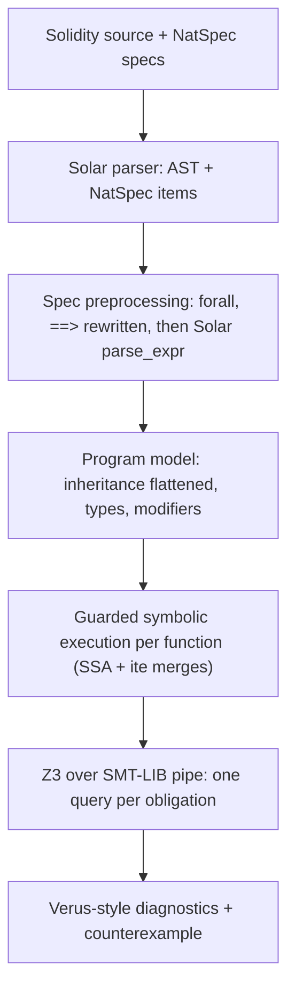

# solar-verify

Deductive verification for Solidity: the `solverus` verifier and the `specmut` spec mutation
tester. Paths below are relative to `crates/verify`.

`solverus` is a deductive verifier for Solidity in the style of [Verus](https://github.com/verus-lang/verus):
you write `requires` / `ensures` / invariants next to the code, and every function is proved
correct **modularly** by Z3. Nothing is bounded, sampled or fuzzed: a ✔ means the property holds
for all inputs and all storage states (modulo the trusted assumptions listed below).

It is built on the compiler's parser: `solar-parse` produces the AST and carries the NatSpec
specs, and spec expressions are themselves parsed by its expression parser, so specs are ordinary
Solidity expressions plus a few spec-only forms.

```
$ solverus examples/Bugs.sol
✘ Bugs.payout (1 of 2 obligations failed)
error: contract invariant must hold before an external call (reentrancy)
   --> examples/Bugs.sol:36:9
    |
 36 |         r.onPayout(amount);
    |
    = in Bugs.payout
    = failing spec: reserved <= deposits
    = spec declared at line 9; checked at line 36
    = counterexample (pre-state): deposits = 1, reserved = 1, amount = 1
```

## Quick start

```sh
sudo apt-get install z3   # any Z3 >= 4.8 on PATH (or SOLVERUS_Z3=/path/to/z3)
cargo build -p solar-verify --release
cd crates/verify
../../target/release/solverus examples/Token.sol
../../target/release/solverus --strict examples/Counter.sol   # panics become errors, see below
cargo nextest run -p solar-verify   # regression suite; skipped when z3 is missing
```

cvc5 and Bitwuzla, when on `PATH` (or `SOLVERUS_CVC5`, `SOLVERUS_BITWUZLA`; `off` disables
them), race z3 on the queries it gives up on.

Flags: `--strict`, `--timeout MS` (per obligation, default 10000), `--only Contract[.fn]`,
`--dump-smt FILE` (the exact SMT-LIB sent to Z3).

## The spec language

Specs live in NatSpec `@custom:` tags, so annotated contracts still compile with `solc`/`solar`
unchanged and the specs cost no gas (like Verus' erased ghost code).

| Where | Tag | Meaning |
|---|---|---|
| function | `@custom:requires e` | precondition: assumed in the body, **checked at every internal call site** |
| function | `@custom:ensures e` | postcondition: checked on every normal return; assumed by callers |
| function | `@custom:trusted` | don't verify the body; callers use its contract (Verus `external_body`) |
| function | `@custom:spec` | single-`return` function usable inside specs (pure/view ones are automatically) |
| contract | `@custom:invariant e` | assumed on entry to every public/external function, checked at each exit, after the constructor, and **before every external call** |
| contract | `@custom:ghost T name` | ghost state variable (spec-only, starts at zero) |
| contract | `@custom:reentrancy-guard v` | `v` is a lock: entry points that use `v` must revert while it holds; calls made under the lock can then reach only the entry points that never mention `v` |
| contract | `@custom:lock-stable P` | every entry point callable under the lock keeps `P` true (proved for each); a call made under the lock keeps `P` if it held before |
| statement | `@custom:invariant e` | loop invariant (on `for`/`while`) |
| statement | `@custom:decreases e` | termination measure: must stay `>= 0` and strictly decrease each iteration |
| statement | `@custom:assert e` | ghost assertion: proved, then known (Verus `assert`) |
| statement | `@custom:assume e` | trusted assumption (use sparingly) |
| statement | `@custom:ghost x = e` | ghost update, executed before the statement |
| function | `@custom:check P` | **checked claim**: `--instrument` emits `require(P)` at the body's start; verification assumes it there and callers are never blamed for it. A note says when the solver proves it anyway, so it can become a `requires` |
| statement | `@custom:check P` | the same before a statement: a runtime check, then a fact (Vox `assume_`) |
| statement | `@custom:use L(args)` | **erased lemma call**: proves `L`'s requires here and adds its ensures as facts. `L` is a `pure` function, verified on its own; a lemma may not reach the function that uses it |
| function | `@custom:opaque` | a spec function seen as an uninterpreted function; its body only through `@custom:reveal f(args)` (Vox `[@def]` / `_def`). Spec functions without it stay transparent |
| statement | `@custom:reveal f(args)` | unfolds opaque `f` once at that application |
| struct | `@custom:invariant P` | **struct invariant** over its fields (`lo <= hi`): proved at every construction and every storage write, required of the zero value, assumed of values read from storage |
| interface | `@custom:requires` / `ensures` | **exported contract** of an external call, over its parameters and returns: callers prove the requires, and the ensures are trusted of the callee |

Spec expressions are Solidity expressions with **mathematical integers** (no overflow in specs,
as in Verus spec code), plus `__time` (the latest `block.timestamp` the contract has seen; every call
starts at or after it, since block time never goes backwards) and:

* `old(e)`: value of `e` in the function's pre-state (postconditions, loop invariants)
* `result`: the single return value (or use named return variables)
* `a ==> b`, `a <==> b`
* `forall uint256 i, address a :: body` and `exists T x :: body` (binders range over their type)
* calls to spec functions (pure/view functions whose body is one `return`)

Example (`examples/ArrayMax.sol`):

```solidity
/// @custom:requires xs.length > 0
/// @custom:ensures forall uint256 j :: j < xs.length ==> xs[j] <= m
/// @custom:ensures exists uint256 j :: j < xs.length && xs[j] == m
function max(uint256[] memory xs) internal pure returns (uint256 m) {
    m = xs[0];
    /// @custom:invariant 1 <= i && i <= xs.length
    /// @custom:invariant forall uint256 j :: j < i ==> xs[j] <= m
    /// @custom:invariant exists uint256 j :: j < i && xs[j] == m
    /// @custom:decreases xs.length - i
    for (uint256 i = 1; i < xs.length; i++) {
        if (xs[i] > m) m = xs[i];
    }
}
```

## Design



**Semantics of reverts.** Execution state is `(guard, env)`: `guard` is an SMT boolean naming the
non-reverting paths that reach the current point, `env` maps every variable to its SSA term.
`require`, `revert`, and Solidity 0.8 panics (overflow, division by zero, out-of-bounds, `pop` on
empty) *narrow the guard*. A reverted transaction has no effect, so postconditions and invariants are
only owed on normal returns. That matches the EVM exactly. `--strict` turns panics into proof
obligations instead, which is Verus' default (prove no overflow ever happens). Solidity `assert`
is always an obligation.

**Encoding.** Integers are SMT `Int` with type-range facts (Verus' choice over bit-vectors: much
better automation for arithmetic specs). `unchecked` arithmetic and narrowing casts wrap with `mod`;
signed `/` and `%` truncate toward zero; bitwise ops go through `int2bv`/`bv2int`.
Mappings are SMT arrays (nested for nested mappings), dynamic arrays are `(array, length)` pairs,
enums are bounded ints. `keccak256` of `k` bytes is one uninterpreted function `keccak(k, value)`
shared by Solidity and inline assembly: `abi.encode` of static values (structs expanded into their
fields) is the big-endian value of its 32-byte words, so `keccak256(abi.encode(x, y))` and an
assembly `keccak256(0, 0x40)` over `x` and `y` are the same term. `abi.encodePacked` and dynamic
arguments keep their own uninterpreted functions. `if` merges both branches with `ite`, so verification
is linear in code size, not exponential in paths. Every `return`, `break` and `continue` snapshots
its state and the snapshots are merged at the join point.

**Inline assembly (Yul)** (`src/yul.rs`). Assembly runs in the same guarded symbolic executor.
Yul values are uint256 words with EVM semantics: wrapping `add`/`sub`/`mul`, division and modulo by
zero give 0, comparisons give 0/1, bitwise operations go through the bitvector view. Words are kept as
linear forms where possible, so slot idioms normalise to one term (Solady's `mstore(0x0c, seed)`,
`mstore(0x00, owner)`, `keccak256(0x0c, 0x20)` and `mstore(0x0c, or(shl(96, owner), seed))` both hash
`owner * 2^96 + seed`). `if`/`switch` merge like Solidity `if`, `revert` ends the path, Yul functions
are inlined (with `leave`), `log*` only evaluate their arguments. `sload`/`sstore` read and write a
ghost `__raw : mapping(uint256 => uint256)` that is havocked at external calls and appears in modify
sets like any state variable. Memory is modelled per assembly block at constant offsets: bytes map to
slices of the words stored there, unwritten memory reads as an arbitrary word, and a Solidity memory
struct used as a pointer is a region holding its fields as ABI words (`keccak256(p, 5 * 32)` equals
`keccak256(abi.encode(p))`). Symbolic memory offsets, Yul `for` loops, `call`/`delegatecall`/`create`,
`return`/`stop`, `.slot`/`.offset` and writes outside the scratch space `0x00-0x7f` are reported
unsupported. `tload`/`tstore` use a second ghost map `__traw` (EIP-1153 transient storage), and
`transient` state variables are ordinary state that is arbitrary when a call starts (it may be a
reentrant call in the same transaction); since transient storage is cleared when the transaction
ends, an invariant that mentions transient state must also hold with it cleared. `call` and
`create`/`create2` are external calls (reentrancy, value accounting as above), with their output
buffer becoming unknown. Solidity `bytes`/arrays used in assembly are opaque pointers: reads
through them (`mload`, `calldataload`, `keccak256` of untracked memory, `x.offset`) give arbitrary
words, writes through them stay unsupported; `revert(add(data, 32), mload(data))` simply ends the
path. `mload(0x40)` is the free memory pointer (assumed below 2^32, which no block's gas can
exceed), and memory-safe writes at `ptr + k` are modelled like scratch memory. In specs, a view/pure function without a single `return` (such as an assembly getter)
is evaluated from its straight-line body; one that branches or may revert is unsupported there.

**Modularity (Verus).** A call to a function with a contract is replaced by: check `requires`,
havoc exactly the state it may write (a syntactic, transitive modifies set), assume `ensures`.
Functions without a contract are inlined (bounded depth; recursion needs a contract). Loops are cut
with their invariants: check on entry, havoc what the body writes, assume, run one arbitrary
iteration, check preservation (and `decreases`).

**External calls and reentrancy (solc-verify / VeriSol).** An external call to a non-view function
may reenter any public function. So the contract invariants must hold *before* the call, all
storage is then havocked and the invariants are re-assumed. This is how `Bugs.payout` is caught.
With `@custom:reentrancy-guard locked`, every non-view entry point that mentions `locked` (in its
body or modifiers) must provably revert while it is set. The others stay callable under the lock
(owner setters without `nonReentrant`, as in Nouns): a call made while `locked` provably holds
checks the invariants, havocs only what those open entry points can write (their own external calls
run under the same lock, so the union of their writes is closed), and re-assumes the invariants and
any `@custom:lock-stable` property that held before. Each open entry point is proved, starting
under the lock from a state satisfying the invariants, to keep every lock-stable property. With no
open entry points, storage is intact across the call, so a correct `nonReentrant` contract like
`examples/Vault.sol` verifies without CEI gymnastics. View and pure interface calls never havoc.
`.transfer` doesn't either, since its 2300-gas stipend cannot write storage.

**Libraries.** Library code runs inlined with the calling contract's state out of its reach (it can
only touch it through storage parameters, raw storage and external calls): an external call made
inside a library (SafeERC20, Address) havocs the contract's state and checks its invariants exactly
like one made in the contract. A `@custom:trusted` library function is trusted not to reenter (a
NONDET-style summary).

**Spec placement.** A statement spec attaches to the statement after it. A `@custom:assert` or
`@custom:assume` after the last statement of a block runs when that block ends; any other spec
comment that no statement carries (a `@custom:ghost` before a closing brace) is an error in its
function, never silently dropped. A spec with text left over after its expression
(`a == b c`) is an error, never checked as its prefix.

**abi.decode.** Decoded values are arbitrary values of their types (decode reverts are not
modelled, an over-approximation of the paths that return). Scalars (`bool`, integers, addresses,
enums) are a function of the decoded bytes, as `keccak256` is: a spec naming
`abi.decode(data, (bool))` sees the value the code decoded from the same `data`. Structs,
nested ones included, decode to fresh field values.

**Transient reentrancy locks.** `@custom:reentrancy-guard` also takes a boolean expression, such as
OpenZeppelin's `ReentrancyGuardTransient`: `__traw[uint256(REENTRANCY_GUARD_STORAGE)] != 0`. Entry
points that reach a state name of the expression (through their modifiers and internal calls) must
revert while it holds; the others stay callable under the lock, as above.

**ETH.** `__balance` is a ghost mapping of account balances. Invariants and requires describe
the state before the transaction; then `msg.value` is credited (non-payable entry points revert
on value). `transfer`, `send`, `call{value: v}` and high-level calls with `{value: v}` debit `v` before
the callee runs (a failed low-level call moves nothing; a successful one implies the balance covered
it). Across any external call, even under a lock, this contract's balance can only grow (forced
sends) unless reentered code may move ETH, in which case it is havocked.

**try/catch.** The callee either returns, and the first clause runs with its results, or reverts,
undoing its effects, and one of the catch clauses runs; the choice is nondeterministic.

**Ghost state (Certora-style).** Sums over mappings can't be expressed directly, so a ghost variable
plus ghost updates next to the writes (`examples/Token.sol`: `totalSupply == sumBalances`) carry
the bookkeeping. The ghost updates are trusted to mirror the code, exactly like Certora hooks
written by hand.

**Vacuity check.** If no execution of a function can return normally (contradictory
`requires`/invariants, or it always reverts), solverus warns, so an inconsistent spec can't
silently verify everything.

## Lessons from Vox

[Vox](https://github.com/julesjacobs/oxcaml/tree/vox) (Jules Jacobs' verifier for OxCaml) shaped
five features, each tested as an accepted program next to a rejected one whose counterexample the
test pins (`// expect:` comments above a function; see `tests/cases/vox.sol`):

* **Checked claims** (`assume_`): `@custom:check P` and `solverus --instrument OUT.sol FILE.sol`.
  Verification holds for the instrumented file, which is what to deploy. The text of P must run as
  Solidity (no `old`, quantifiers or `==>`): runtime arithmetic either reverts or equals the
  mathematical value, so a passing require establishes P.
* **Erased proofs** (`ghost_`, `[@def]`): `@custom:use`, `@custom:opaque`, `@custom:reveal`. They
  are NatSpec, and a lemma no code calls is dropped by solc: runtime bytecode is identical with and
  without them (checked with solc 0.8.30 `--optimize --metadata-hash none`).
* **Modular interfaces**: interface functions' requires/ensures are the contract external calls
  are checked against. Internal and library functions with a contract were already modular.
* **Implementations inherit interface contracts**: a contract implementing an interface function with specs proves its ensures (under its requires) for the body, so what callers trust is checked when the implementation is in the file. Use the interface's parameter and return names. In an interface spec, msg.sender is the calling contract.
* **Dependent struct fields**: struct invariants, as above. Calldata and external results are
  never trusted to satisfy one: storing or pushing them needs a check. Inline assembly writes only
  the raw slots solverus already assumes disjoint from declared state, so it cannot break one.
* **Test style**: `// expect: text` pins what a function's diagnostics say.

Not taken: Vox's credit tokens for resource bounds (solverus does not model gas), and lemma
termination measures (a lemma may not reach itself through calls or uses, which covers what
`@custom:use` needs). NatSpec tags must be lowercase letters and `-` for solc: write
`@custom:succeeds-if`, not `succeeds_if`.

## Spec mutation testing

`tools/specmut.py` measures how much a file's specs pin down: it mutates the implementation of
every function that verifies (relational, arithmetic, logical, constant and boolean replacement,
deletion of effects and revert guards) and re-verifies the mutant and every function that can
reach it. A mutant is killed only when solverus reports a failure with a counterexample; a
surviving mutant whose optimized runtime bytecode equals the original's is equivalent (trivial
compiler equivalence, which needs `solc`), and the rest are reported with their diffs for triage.
Triage records live next to the file in `<file>.equiv.json`.

```sh
python3 tools/specmut.py --bin ../../target/release/solverus -j 8 examples/Token.sol
```

It needs only Python's standard library. `--list` prints the mutants without verifying them,
`--only REGEX` restricts them to matching `Contract.fn`, `--rerun` re-runs survivors after the
specs change, and `--solc` picks the compiler for the equivalence check.

## Prior art and what we took from it

* **Verus** (Lattuada et al., *Verus: Verifying Rust Programs using Linear Ghost Types*, OOPSLA 2023;
  *Verus: A Practical Foundation for Systems Verification*, SOSP 2024). Spec/proof/exec
  separation with erased ghost code, mathematical integers in specs, direct SMT encoding, and
  modular `requires`/`ensures`. solverus' NatSpec specs are the Solidity analogue of erased spec code.
* **solc-verify** (Hajdu & Jovanović, *solc-verify: A Modular Verifier for Solidity Smart
  Contracts*, VSTTE 2019). Annotations in comments, contract invariants at public boundaries and
  before external calls, and mappings as SMT arrays.
* **VeriSol** (Wang et al., *Formal Specification and Verification of Smart Contracts for Azure
  Blockchain*, 2019). Havocking storage at external calls with invariants as the reentrancy contract.
* **SolCMC / SMTChecker** (Alt et al., *SolCMC: Solidity Compiler's Model Checker*, CAV 2022).
  Fully automatic CHC-based checking inside solc. A good future source of *candidate* invariants
  for solverus to check.
* **Certora Prover / CVL**. Ghost variables updated alongside storage writes, and summaries for
  external calls.

## Status and limits (v0.1)

Supported: value types, enums, nested mappings, storage and memory dynamic arrays (`push`/`pop`/
`length`), modifiers (including code after `_`), single-file inheritance, libraries (`Lib.f(..)`),
internal calls (modular or inlined), interface and low-level external calls, tuples, `unchecked`,
casts, `type(T).max`, ether and time units, `keccak256`.

Also: `super`, file-level and library constants (`Lib.K`, `Lib.Enum.V`, `Lib.Struct({..})`),
`I.f.selector`, `type(I).interfaceId`, `new` (contracts as external calls, memory arrays zeroed),
typed `abi.decode`, slices, `bytes.concat`, `msg.data`/`msg.sig`/`tx.gasprice`/`block.basefee`, and
storage pointers returned by internal functions (`C storage c = _get(i)` follows the location the
inlined callee returns, with its index values captured at the call). A solver error in a function
makes its checks unknown, never verified.

Not yet: Yul `for` loops, writes at symbolic memory offsets and `.slot` in inline assembly, `do/while`, multi-file imports, fixed-size
array bounds, storage pointers set from conditionals or contract-specified callees, function pointers, other accounts' code (`.balance` of other addresses is tracked only for this contract's own transfers),
and explicit quantifier triggers (Z3 picks them). Unsupported constructs are reported as errors
rather than skipped, so a ✔ is never produced over code solverus didn't model.

Trusted base: Solar's parser, the encoding in `src/vc.rs`, Z3, ghost updates and `@custom:assume` /
`@custom:trusted`, and the assumption that other contracts can only reach this contract's storage
through its public functions (no `delegatecall` into it, no selfdestruct tricks).
Hashing and inline assembly add these assumptions, as halmos and Certora make them:
`keccak` is injective (ground inverse facts `len(keccak(l, v)) = l`, `val(keccak(l, v)) = v` on each
hash term; a hash inside a quantified spec gets them through equal terms of the body) and its results
lie in `[2^128, 2^256)`, so they never collide with small constant slots; raw storage slots that
assembly reaches are disjoint from the declared state variables; assembly is memory-safe (it writes
only the scratch space and does not clobber Solidity's memory objects); and a struct pointer's
region is placed at a fixed high address no constant-offset write reaches.
